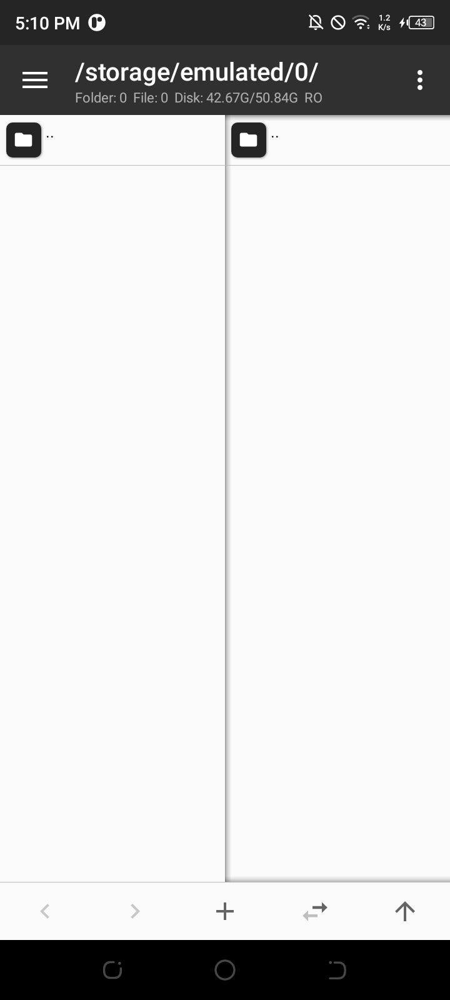

# OpenMT 0.1 (`y.open.mt`)

**OpenMT** es una versión completamente abierta, libre de telemetría y reconstruida tanto a nivel **Java** como **C/C++ nativo** a partir de MT Manager (v2.7.3). 

---

## 🚀 Novedades de OpenMT 0.1

1. **Recompilación C/C++ Nativa con Android NDK r27c Clang:**
   - La librería nativa central (`libFeatures.so`) fue desensamblada, analizada en C++ y recompilada desde código fuente (`src/native/openmt_features.cpp`) con soporte estático a la STL (`-static-libstdc++`), compatibilidad `arm64-v8a` y enlace dinámico con delegación de análisis Itanium demangler.
   - Logs nativos directos con el tag `OpenMT_Native` verificando la carga y llamadas JNI (`Features.get`, `Features.uid2name`, `Features.analyze`).

2. **Limpieza 100% de Trackers y Telemetría:**
   - **Umeng Analytics / Push:** Neutralizadas todas las inicializaciones (`UMConfigure.init`, `MobclickAgent`).
   - **UTDevice / Alipay SDK:** Neutralizado `UTDevice.getUtdid` y eliminado rastreo en segundo plano.
   - **Facebook SDK:** Eliminado `FacebookInitProvider` del manifiesto; neutralizado el SDK para evitar fugas de telemetría y solventado el fallo de `ApplicationContext`.
   - **Firebase Measurement & Billing:** Proveedores y receptores de facturación/métricas completamente removidos.

3. **Neutralización de Bloqueos e Integridad:**
   - Interceptores reflexivos en `Method.invoke` para llamadas dinámicas a `exit()`.
   - Neutralizado el cierre programado (`OpenMTExit`), permitiendo la apertura permanente del explorador de archivos.

4. **Identificador y Versionado Limpio:**
   - **Package ID:** `y.open.mt`
   - **Versión:** `0.1` (versión de código `1`)
   - **Firma:** Esquemas v1, v2 y v3 válidos para Android 11 hasta Android 16.

---

## 📸 Evidencia de Ejecución en Dispositivo Físico

Prueba ejecutada en vivo en un dispositivo conectado (**Android 11 arm64-v8a**):



### Registro de Logcat en Vivo:
```text
I OpenMT_Native: =================================================
I OpenMT_Native:    OpenMT 0.1 C/C++ Native Engine Loaded!       
I OpenMT_Native:    Compiled with Android NDK r27c Clang         
I OpenMT_Native: =================================================
I OpenMT_Native: Loaded libFeatures_orig.so and resolved symbols successfully.
I OpenMT_Native: [OpenMT C/C++] Features.analyze() called!
...
E OpenMT_Exit: PREVENTED SYSTEM.EXIT with code: 0
```

---

## 📁 Estructura del Repositorio

```
openMT/
├── src/
│   ├── native/                  # Código fuente C/C++ de libFeatures.so
│   │   └── openmt_features.cpp  # Implementación nativa JNI NDK r27c
│   ├── java/                    # Fuentes Java decompilados completos
│   └── cpp/                     # Pseudocódigo de versiones previas
├── dist/
│   └── OpenMT_0.1.apk           # APK final compilado, firmado y verificado
├── screenshots/                 # Capturas de pantalla de prueba de ejecución
└── README.md
```

---

## 📥 Descarga de OpenMT 0.1

El archivo APK listo para instalar se encuentra en [`dist/OpenMT_0.1.apk`](dist/OpenMT_0.1.apk).
